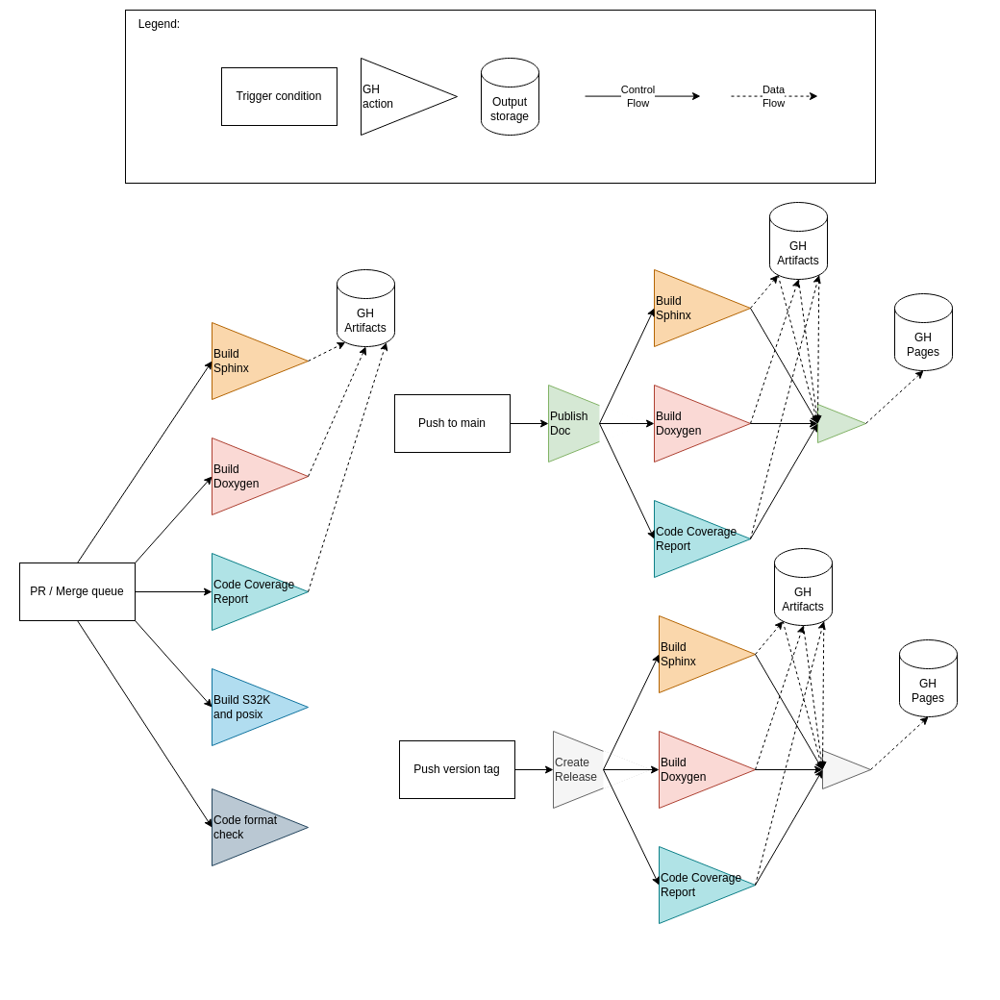

<!--
 *******************************************************************************
  Copyright (c) 2024 Accenture

  This program and the accompanying materials are made available under the
  terms of the Apache License Version 2.0 which is available at
  https://www.apache.org/licenses/LICENSE-2.0

  SPDX-License-Identifier: Apache-2.0
 *******************************************************************************
-->

# Github Workflows

## Overview

To ensure a stable main branch, we verify PRs (Pull Requests) once they are created or updated and again in the merge queue before they are merged. Both are driven by [ci.yml](ci.yml), which is triggered by `pull_request` and `merge_group` and calls every verification workflow as a reusable workflow. Its `ci-gate` job aggregates the results of all called workflows and is the only required status check of the `main` branch ruleset (besides the Eclipse ECA check). Please refer to the above diagram to clearly understand the workflow of our CI.

To add a new verification workflow:

1. Give it only a `workflow_call` trigger (no `push`, `pull_request` or `merge_group` triggers, otherwise it runs redundantly).
2. Call it from a new job in [ci.yml](ci.yml).
3. Add that job to the `needs` list of `ci-gate`.

Called workflows inherit the read-only token permissions of [ci.yml](ci.yml), so they must not request write permissions.

Verification workflows are intentionally not triggered by `push`: a `push` trigger would run them on every branch push in addition to the `pull_request` run, and re-running them on `main` after a merge is redundant because the merge queue already verified the exact commit that becomes the new `main`. The only workflows triggered by `push` are [publish.yml](publish.yml) (publishes the documentation from `main`) and [release.yml](release.yml) (release tags).

## General guidelines

1. Don't waste compute time.
2. Each job should have a specific purpose.
3. Each artifact produced should make sense on its own.
4. Don't rely on a different job running afterwards.
5. Each job should have a unique name.

## Ubuntu runner version

All jobs use `ubuntu-26.04` explicitly so that upgrades to a new Ubuntu release
are deliberate rather than inherited from `ubuntu-latest`. This pins the OS
release, not the runner image revision or kernel version.

The POSIX pytest job loads `can`, `can-raw`, and `vcan` directly before creating
`vcan0`. The Ubuntu 26.04 runner's Azure kernel includes these modules in
`linux-modules`, installed with the kernel; the separate `linux-modules-extra`
package is no longer published for that kernel. Module loading must succeed
before the tests run; missing CAN support must not be silently skipped.

## PR Verification Process

1. Code Review: Reviewers check for code quality, functionality, and adherence to coding standards.
2. Automated Checks: The CI workflows run automated checks, including builds, tests, format_check, code coverage, and documentation generation.
3. Manual Testing: Reviewers perform manual testing if necessary to verify functionality.
4. Approval and Merge: Once the PR passes all checks and reviews, it is approved and added to the merge queue ("Merge when ready"). The merge queue combines the PR with the latest `main` (and any PRs queued ahead of it), re-runs all required checks on the result and merges it automatically if they pass. If a check fails, the PR is removed from the queue.
5. Post-Merge: No verification checks are re-run on `main`, since the merge queue already verified the merged result. Only the documentation is published from `main`.