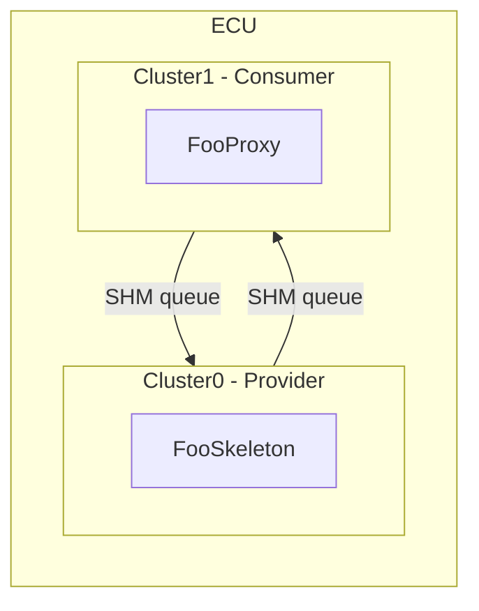

<!--
 *******************************************************************************
  Copyright (c) 2026 BMW AG

  This program and the accompanying materials are made available under the
  terms of the Apache License Version 2.0 which is available at
  https://www.apache.org/licenses/LICENSE-2.0

  SPDX-License-Identifier: Apache-2.0
 *******************************************************************************
-->

# Middleware Simulation Example

- [Overview](#overview)
- [Concepts](#concepts)
- [Configuration](#configuration)
- [Structure](#structure)
- [Initialization](#initialization)
- [Services](#services)
- [Communication](#communication)
  - [Attribute Broadcasts](#attribute-broadcasts)
  - [Attribute Get](#attribute-get)
  - [FooMethod and Application Polling](#foomethod-and-application-polling)
- [Building](#building)

---

## Overview

This example illustrates the basic principle of how the middleware communicates
between software components on different cores. It uses POSIX shared memory
(SHM) to implement the inter-core queues so that the simulation can run on any
Linux host without real embedded hardware.

Two logical cores are simulated:

| Core  | Role                | Service Role |
|-------|---------------------|-------------|
| Cluster0 | Provider / Server   | `FooSkeleton` — provides the `Foo` service |
| Cluster1 | Consumer / Client   | `FooProxy`   — consumes the `Foo` service  |

At startup a shared memory segment is created and the `MemoryLayout` (queues and
allocator pools) is constructed in it via placement new. Both cores are then
started either as **threads** (default) or as **OS processes** (compile-time
option).

---

## Concepts

| Term                    | Description |
|-------------------------|-------------|
| ECU                     | Electronic Control Unit. In this simulation the host process is considered to be the ECU. |
| Proxy                   | A class providing the API for using a service. Instantiated by the service consumer. |
| Skeleton                | A class providing the API for providing a service. Instantiated by the service provider. |
| Service Provider/Server | A software component offering a service. |
| Service Consumer/Client | A software component using a service from a provider. |
| Attribute               | A typed property on the service provider side, defined as part of the service interface. |
| Method                  | An asynchronous request/response operation; the simulation exposes the FooMethod response through application polling. |

---

## Configuration



The deployment model (`model/deployment-test.yaml`) describes:

- **Two clusters**: `Cluster0` (id 0) and `Cluster1` (id 1).
- **One service**: `Foo` (namespace `org::test::foo`, id 1) with a
  read/write attribute `FooDefault` of type `FooStruct { uint32_t fooValue }`
  and method `FooMethod(uint32_t)` returning `FooMethodResult`, an `etl::array<uint32_t, 4>`.
- **Two connections**:
  - `Cluster0 -> Cluster1` skeleton-only: Cluster0 provides `FooSkeleton`.
  - `Cluster1 -> Cluster0` proxy-only: Cluster1 consumes `FooProxy`.

---

## Structure

```
libs/bsw/middleware/simulation/
+-- model/
|   +-- deployment-test.yaml        # Deployment YAML fed to jinja2cpp.py
+-- include/
|   +-- etl_profile.h               # ETL config for host
|   +-- foo/
|   |   +-- FooSkeletonWrapper.h    # FooSkeleton concrete impl (Cluster0)
|   |   +-- FooProxyWrapper.h       # FooProxy wrapper (Cluster1)
|   +-- Logger.h                    # Thread-safe simulation logger
+-- platform_integration/
|   +-- concurrency/include/middleware/concurrency/lock_types.h
|   |                               # ScopedCoreLock / ScopedECULock no-op stubs
|   +-- logger/src/LoggerImpl.cpp  # middleware::logger::log() via fprintf
|   +-- os/src/OsDefinitions.cpp   # middleware::os::getProcessId()
|   +-- time/src/SystemTimeProvider.cpp
+-- src/
|   +-- Logger.cpp
|   +-- MainCore0.cpp               # Cluster0 entry point (FooSkeleton provider loop)
|   +-- MainCore1.cpp               # Cluster1 entry point (FooProxy consumer loop)
|   +-- Sample.cpp                  # main(): creates SHM, spawns cores
|   +-- ShmWrapper.cpp              # SHM open/mmap wrapper
|   +-- ShmWrapper.h
+-- docs/
|   +-- README.md                   # This file
+-- test/
|   +-- FooMethodTest.cpp           # FooMethod integration tests (real generated code)
+-- BUILD.bazel
+-- CMakeLists.txt
+-- generated_outputs.bzl           # Expected generated file lists (Bazel)
```

---

## Initialization

```
main()
  +- ShmWrapper::init()          -- opens / creates the POSIX SHM segment
  +- createMemoryLayout()        -- placement-new of queues + pools in SHM
  +- [thread|fork] Cluster0         -- run_main_cluster0()
  +- [thread|fork] Cluster1         -- run_main_cluster1()
```

**Cluster0 startup** (`run_main_cluster0`):

1. `middleware::initializeCluster0ClusterConnection()` — wires the Cluster0-side
   cluster to its SHM queues.
2. `FooSkeletonWrapper::init()` — registers the `Foo` service on Cluster0 with
   `InstanceId_1`.
3. Main loop: calls `sendBroadcast()` every 5 s, processes incoming messages,
   logs stats every 15 s, exits after 60 s.

**Cluster1 startup** (`run_main_cluster1`):

1. `middleware::initializeCluster1ClusterConnection()` — wires Cluster1 to its SHM
   queues.
2. `FooProxyWrapper::init()` — registers a change-notification callback on
   `fooDefault` and initialises the `FooProxy` on Cluster1.
3. Main loop: calls `requestGet()` and `requestFooMethod()` every 6 s, processes
   incoming messages, calls `pollFooMethod()` after each processing step, logs stats
   every 15 s, exits after 60 s.

---

## Services

### Foo

| Property       | Value |
|----------------|-------|
| Namespace      | `org::test::foo` |
| Service id     | 1 |
| Instance id    | `InstanceId_1` = 1 |
| Attribute      | `FooDefault` -- `FooStruct { uint32_t fooValue }` |
| Access         | read / write / subscribe |
| Method         | `FooMethod`, member id 3, timeout 5000 ms, one request per consumer/provider |

The `FooSkeletonWrapper` (Cluster0) increments `fooValue` on every broadcast.
The `FooProxyWrapper<Cluster1>` receives broadcasts via a registered callback and
also issues explicit getter requests.

---

## Communication

### Attribute Broadcasts

When `FooSkeletonWrapper::sendBroadcast()` is called the skeleton writes the
updated `FooStruct` into the SHM queue towards Core1. The middleware event
mechanism delivers it to the change-notification callback registered via
`fooDefault.setReceiveHandler(...)` on the proxy side.

```
Cluster0 FooSkeleton::fooDefault.send(data)
         |
         v   SHM queue (Cluster0 -> Cluster1)
Cluster1 FooProxy::onFooDefaultChanged(val)  <- setReceiveHandler callback
```

### Attribute Get

`FooProxyWrapper::requestGet()` sends a getter request through the SHM queue.
The skeleton's `get_FooDefaultAttribute()` override is called, and the response
is routed back to `onGetResponse()` on the proxy side.

```
Cluster1 fooDefault.get(cb)
         |
         v   SHM queue (Cluster1 -> Cluster0)
Cluster0 FooSkeleton::get_FooDefaultAttribute(response)
         |
         v   SHM queue (Cluster0 -> Cluster1)
Cluster1 onGetResponse(val)
```

### FooMethod and Application Polling

`FooMethod(x)` returns exactly four `uint32_t` values: `[x, x+1, x+2, x+3]`.
Arithmetic wraps modulo 2^32: `FooMethod(UINT32_MAX)` returns
`[UINT32_MAX, 0, 1, 2]`. FooMethod does not change the Foo attribute.

1. Cluster1 calls `FooProxyWrapper::requestFooMethod(x)`, which sends a generated
   `FooProxy::fooMethod` request through the SHM queue to Cluster0.
2. Cluster0 dispatches to `FooSkeletonWrapper::fooMethod`, computes the array and
   sends it immediately with `respondFooMethod`.
3. Cluster1 processes the response. The middleware callback **copies** the
   array into the wrapper before the transport releases its response storage.
4. The application calls `pollFooMethod()` without blocking. A terminal result is
   consumed exactly once; the next poll returns `Invalid` (idle).

The middleware remains callback-based; polling is only an application-level
adapter in this simulation. All wrapper operations and middleware dispatch run
on the consumer's thread/process.

| Poll state | Meaning |
|------------|---------|
| `Invalid` | Idle: no outstanding call or unconsumed result. |
| `Pending` | Request is outstanding; polling does not consume it. |
| `Ready` | `value` contains the four result elements; this poll consumes them. |
| Other `Future::State` | Terminal error, including `Timeout`; this poll consumes it. |

Only inspect `value` when the state is `Ready`. `requestFooMethod` returns
`HRESULT::ServiceBusy` while a call is pending **or** a terminal result/error
has not yet been polled. It never overwrites that result. An immediate send
failure is logged and returned as an `HRESULT`, leaving the wrapper idle.
Response errors and the 5000 ms timeout are returned through polling and
logged by the consumer loop. Timeout checking uses the existing middleware
processing cycle. There are no automatic retries; after an error is consumed,
the next regular call may start. `deInit()` clears pending and stored results.

The consumer sends a new start value every 6 seconds and logs every element:

```text
[Cluster1] FooMethod request sent, startValue=0
[Cluster1] FooMethod result, values=[0, 1, 2, 3]
[Cluster1] FooMethod request sent, startValue=1
[Cluster1] FooMethod result, values=[1, 2, 3, 4]
```

The input (4 bytes) and output (16 bytes) fit in the existing inline message
payload. No allocator or queue-size increase is necessary.

---

## Building

### Prerequisites

Standard OpenBSW POSIX build environment (see top-level README).
The simulation ETL profile defines `ETL_USE_TYPE_TRAITS_BUILTINS`. The
simulation executable therefore does not build with the compilers of the
development container (GCC 14/15, Clang 17); Clang 21 with libc++ is the
only verified configuration. The simulation is not built in CI.
The FooMethod unit test does not use this profile and builds with the regular
unit-test configuration.

The simulation requires `BUILD_EXECUTABLE=middlewareSimulation`. This is a
separate build tree from the `referenceApp`; use a dedicated build directory.

```bash
cmake --preset posix-threadx -B build/middleware-sim \
      -DBUILD_EXECUTABLE=middlewareSimulation
cmake --build build/middleware-sim --target middlewareSimulation
```

### Process-based execution

By default the two cores run as **threads** inside a single process.  To run
each core in its own OS **process** (true process isolation via `fork`):

```bash
cmake --preset posix-threadx -B build/middleware-sim \
      -DBUILD_EXECUTABLE=middlewareSimulation \
      -DSIMULATION_USE_PROCESSES=ON
cmake --build build/middleware-sim --target middlewareSimulation
```

### Run

```bash
./build/middleware-sim/libs/bsw/middleware/simulation/Release/middlewareSimulation
```

### Regenerating code

CMake automatically regenerates the C++ code in the build directory when the
deployment model (`model/deployment-test.yaml`) or generator templates change.
For manual generation, also use a build-directory destination:

```bash
python3 libs/bsw/middleware/tools/cpp_generator/jinja2cpp.py \
  --input  libs/bsw/middleware/tools/cpp_generator \
  --output build/middleware-sim/libs/bsw/middleware/simulation \
  --deployment-yaml libs/bsw/middleware/simulation/model/deployment-test.yaml
```

See `libs/bsw/middleware/tools/cpp_generator/README.md` for full generator
documentation.

### Tests

The FooMethod tests use the real generated proxy, skeleton and queues, with an
in-process memory layout and a deterministic clock. They cover exact array
values and overflow, polling states, busy handling, response storage lifetime,
send failures, response errors, timeout/late responses and deinitialization.
They do not require a running referenceApp or real-time sleeps.

```bash
cmake --preset tests-posix-debug -B build/middleware-tests
cmake --build build/middleware-tests \
  --target middlewareSimulationFooMethodTest middlewareRequestResponseTest \
           middlewareClusterConnectionTest
ctest --test-dir build/middleware-tests/libs/bsw/middleware/test -C Debug \
  -R 'FooMethodTest|ProxyMethod|ProxyFireAndForget|ResponseBuffer|ConfigurationBaseTest|ConnectionBaseTest' \
  --output-on-failure
```

The corresponding Bazel target is
`//libs/bsw/middleware/simulation:middleware_simulation_foo_method_test` in the
`unit_test` build variant.

Error responses are routed to the requesting proxy just like successful
responses. Dispatcher regression tests cover this routing, unknown proxy
addresses and rejection of error responses by the skeleton endpoint.
